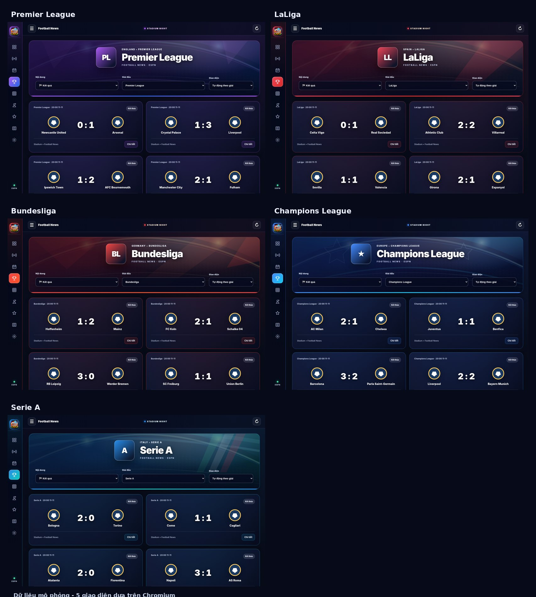

# Football News · Chỉ sử dụng dữ liệu ESPN

**Phiên bản 2026.11.13.8** — Home Assistant 2026.11+, tiếng Việt và giao diện sáng/tối.

Football News sử dụng **ESPN** cho lịch thi đấu, kết quả, bảng xếp hạng, tin bóng đá và thống kê cầu thủ. Không yêu cầu API key hoặc tích hợp dữ liệu khác. Zalo Bot chỉ dùng để **gửi thông báo**, không cung cấp dữ liệu bóng đá.

> **Lưu ý:** Các JSON endpoint ESPN được sử dụng là nguồn công khai nhưng **không có hợp đồng API chính thức**. Trang web ESPN có thể đòi xác minh trình duyệt; bản tích hợp không tìm cách vượt qua cơ chế bảo vệ đó. Số liệu thiếu sẽ không được tự tạo.

[](https://my.home-assistant.io/redirect/marketplace_repository/?owner=khaisilk1910&repository=Football-News&category=integration)


## Stadium Night — Giao diện được xây dựng lại hoàn toàn



**Không còn giao diện cũ cộng thêm banner.** Stadium Night thay toàn bộ bố cục dashboard: thanh điều hướng biểu tượng ở cạnh trái trên desktop; thanh trên cùng gọn nhẹ; khu vực sân vận động tích hợp trực tiếp **logo/tên giải, chọn Nội dung, Giải đấu và Giao diện**; thẻ trận với logo/tỷ số lớn; bảng xếp hạng dạng bảng thể thao tối, cột chỉ số căn giữa; khối tin tức, cầu thủ và CLB theo cùng hệ thiết kế.

**Năm bộ nhận diện:** Premier League (tím), LaLiga (đỏ), Bundesliga (đỏ/cam), UEFA Champions League (xanh điện), Serie A (xanh lam/ngọc). Ở bộ chọn **Giao diện**, dùng **Tự động theo giải** (mặc định) hoặc cố định một kiểu. Tùy chọn chỉ lưu cục bộ trong trình duyệt.

**Responsive:** desktop hiển thị thanh rail và lưới 2 cột; điện thoại ẩn rail, giữ nút mở menu Home Assistant và xếp thẻ trận thành 1 cột. Tên CLB có thể xuống dòng, logo/tỷ số tự điều chỉnh theo thẻ; bảng xếp hạng có vùng cuộn ngang nội bộ khi quá hẹp. Các phần vẫn giữ tương thích với dropdown, đội yêu thích, popup, thông báo Zalo và dữ liệu cache.

**Tối ưu tốc độ:** 5 hình sân vận động khác nhau là SVG nội bộ (mỗi file khoảng 1,6–1,8 KB), không có thư viện frontend, font ngoài hoặc ảnh nền lớn. Giao diện không gọi thêm ESPN khi đổi màu. Logo CLB chỉ dùng link có sẵn trong feed ESPN và tải lazy; không tải chân dung cầu thủ. RAM/cache `.storage` và đồng bộ ESPN nền không đổi. Đồ họa dùng CSS chuyển màu nhẹ và tôn trọng `prefers-reduced-motion`.

Chú ý: Giao diện Stadium Night có tông tối chủ đạo để phù hợp ảnh tham chiếu, độc lập với màu theme của Home Assistant. Các thành phần vẫn có độ tương phản cao và hoạt động trong cả chế độ sáng/tối của Home Assistant.

## 2026.11.13.8 — Dữ liệu ESPN và cache khi tải lại

Bản này khắc phục trường hợp Home Assistant hiển thị `Standings response has no standings content` khi ESPN trả HTTP 200 nhưng payload không có bảng xếp hạng thực tế. Bộ đọc hỗ trợ cấu trúc bảng lồng nhau, dùng tối đa một endpoint dự phòng cũng thuộc ESPN và kiểm tra mùa hiện tại. Nếu cả hai nguồn tạm lỗi, bảng hợp lệ cuối cùng từ RAM/`.storage` vẫn hiển thị (có thời điểm cập nhật, không giả là dữ liệu trực tiếp).

**Lưu `.storage` theo từng dataset:** khi lịch thi đấu tải được trước nhưng bảng xếp hạng tải về sau, dữ liệu bảng vẫn được lên lịch ghi vào HA Store; không còn bị bỏ qua do giới hạn ghi chung 120 giây. `Store` tự trì hoãn ghi ngắn để tránh I/O dồn dập. Cache không thể tạo dữ liệu mà ESPN chưa từng cung cấp; dashboard sẽ cho biết thiếu dữ liệu khi cả cache và upstream đều không có.

**Chẩn đoán:** bật mức debug qua Home Assistant `logger`, ví dụ:

```yaml
logger:
  logs:
    custom_components.football_news: debug
```

Sau đó kiểm tra **Download diagnostics**, trường `updated_at`, `cache_info.restored_datasets`, `errors` của từng giải. Không xóa config entry hoặc tệp `.storage` khi đang kiểm tra vì có thể mất dữ liệu khôi phục. Bản này không khẳng định nguồn ESPN sẽ luôn trực tuyến: HTTP 403/429 và thay đổi schema vẫn có thể xảy ra.

## Cài đặt

### Marketplace

1. Bấm nút trên hoặc mở **Cài đặt → Marketplace** và thêm repository `https://github.com/khaisilk1910/Football-News` dưới loại Integration.
2. Cài Football News, khởi động lại Home Assistant.
3. Mở **Cài đặt → Thiết bị & dịch vụ → Thêm tích hợp → Football News**, chọn từng giải.
4. Trong sidebar mở Football News; chọn giải đấu từ dropdown.

### Thủ công

Giải nén ZIP phát hành `football_news.zip` vào `/config/custom_components/football_news/` sao cho thư mục có trực tiếp `manifest.json` và `__init__.py`. Khởi động lại Home Assistant và thêm tích hợp từ giao diện.

## Tính năng

- Lịch / vòng đấu, kết quả, trận trực tiếp, đội yêu thích, bảng xếp hạng và màu suất dự cúp/xuống hạng.
- Dashboard tiếng Việt có 5 bộ màu sân vận động tự đổi theo giải, phù hợp điện thoại, dropdown và theme Home Assistant sáng/tối.
- Thống kê theo mùa từ ESPN: ghi bàn, kiến tạo, thẻ vàng/đỏ, điểm đánh giá, số trận và số phút nếu feed có đủ dữ liệu được xếp hạng.
- Bảng cầu thủ dạng 4 cột: thứ hạng, **logo câu lạc bộ ESPN**, tên + câu lạc bộ và chỉ số bên phải. Không tải ảnh chân dung cầu thủ; thiếu logo dùng biểu tượng dự phòng.
- Vị trí Top 1/2/3 được nhấn viền vàng/bạc/đồng; hạng tiếp theo sử dụng màu trung tính.
- **Tổng quan:** Top 3 bàn thắng và Top 3 kiến tạo. **Cầu thủ nổi bật:** tối đa **Top 15** của mỗi loại khi ESPN cung cấp đủ cầu thủ; không tự bổ sung vị trí còn thiếu.
- **Bố cục responsive:** trên máy tính có đủ chiều rộng, hai bảng **Vua phá lưới** và **Kiến tạo hàng đầu** hiển thị **hai cột ngang nhau**. Trên điện thoại hoặc vùng nội dung hẹp, tự động xếp thành **một cột**, theo chiều rộng thực tế của panel Home Assistant (không phụ thuộc vào kích thước màn hình thiết bị).
- **SVG mới:** bóng đá có các mảng ghép rõ nét và giày chuyền bóng kèm bóng chuyển động; dùng màu vàng/bạc/đồng cho ba vị trí đầu, không tải ảnh hoặc biểu tượng từ bên ngoài.
- Các nhóm thẻ phạt/đánh giá khác giữ mức Top 3 nếu ESPN có số liệu.
- Thông báo Zalo qua action `zalo_bot.send_message`, danh sách chọn nhiều đội theo ID, nhắc trước trận, bàn thắng và kết quả.
- Không truy vấn mạng trong quá trình khởi động tích hợp. Chỉ nạp bảng cầu thủ khi mở trang cần, cache kết quả 6 giờ, giới hạn yêu cầu đồng thời và ngắt khi ESPN giới hạn truy cập.
- **Cache ba tầng**: RAM trong ESPN provider/coordinator, Home Assistant `.storage` qua `Store` và cache trình duyệt `localStorage` (6 giờ). **Ngay lần đầu mở sidebar**, backend có thể đọc trực tiếp `.storage` theo config entry kể cả khi coordinator chưa khởi tạo; không cần rời dashboard rồi quay lại. Dữ liệu cũ được đánh dấu lưu tạm cho tới khi ESPN cập nhật.
- **Thống kê cầu thủ** được lưu riêng theo giải/mùa, ưu tiên RAM/disk trong thời hạn 6 giờ, không tải ảnh chân dung. Dữ liệu thiếu mạng có thể hiển thị bản đã lưu trong hạn tối đa 24 giờ và có nhãn dữ liệu tạm.
- Dữ liệu từ disk hoặc trình duyệt luôn được **đánh dấu lưu tạm**; không coi trạng thái trực tiếp cũ là đang diễn ra. ID người nhận Zalo, API key, cấu hình tài khoản và danh sách yêu thích cá nhân không được ghi vào cache dữ liệu bóng đá.
- Không có chức năng Donate hoặc cá cược.

## Dữ liệu cầu thủ ESPN

Trang thống kê tham chiếu: https://www.espn.com/soccer/stats/_/league/eng.1

Nguồn JSON ESPN được thử theo thứ tự: `sports.core.api.espn.com/v2/sports/soccer/leagues/{league}/seasons/{season}/types/2/leaders`, `/seasons/{season}/leaders`, `/leaders`, sau đó các endpoint ESPN Site/Web có thể cung cấp cùng nhóm dữ liệu. Định dạng của ESPN có thể thay đổi. Các endpoint này **không phải API hỗ trợ chính thức**. Nếu JSON của ESPN trả dữ liệu khác với trang web, Football News chỉ hiển thị giá trị xác thực được.

Để tránh lỗi 404, tốn băng thông và chờ ảnh, bảng thống kê Football News **không tải ảnh cầu thủ**. Tên, câu lạc bộ, bàn thắng và kiến tạo vẫn đến từ ESPN; biểu tượng bóng và giày chuyền bóng được dựng cục bộ bằng SVG.

Season của Premier League 2026–27 dùng `2026`; các giải theo năm lịch có mùa riêng. Giao diện ẩn bảng Top nếu không có cầu thủ hợp lệ.

## Cache RAM + ổ đĩa và giao diện (2026.11.12.9)

Tích hợp sử dụng ba tầng lưu trữ, không truy vấn ESPN hoặc gọi Zalo trong `async_setup_entry`:

| Tầng | Chức năng | Ghi chú |
|---|---|---|
| RAM | Cache TTL của provider ESPN và bản tốt gần nhất trong coordinator | Phản hồi nhanh khi Home Assistant đang chạy, không ghi đĩa cho mọi lần đọc |
| Ổ đĩa | `homeassistant.helpers.storage.Store`, khóa `football_news_cache_<entry_id>` | Dữ liệu ESPN công khai, tách từng giải và xác minh đúng mùa. Đọc bất đồng bộ ngay từ WebSocket kể cả trước khi coordinator sẵn sàng |
| Trình duyệt | `localStorage` 6 giờ cho dữ liệu công khai, cache thống kê riêng | Hiển thị trước khi WebSocket trở lại; có cảnh báo khi đang dùng cache |

**Thời hạn tối đa để khôi phục từ ổ đĩa:** lịch/kết quả 7 ngày, bảng xếp hạng 14 ngày, tin 2 ngày, thống kê cầu thủ 24 giờ. **Không có nghĩa dữ liệu còn mới**: mỗi nhóm giữ thời điểm cập nhật ESPN gốc, khi khôi phục có cảnh báo, và bộ đếm trận trực tiếp của Home Assistant chỉ có hiệu lực khi đã cập nhật lịch mới. Phản hồi lỗi không ghi đè dữ liệu tốt; nếu ESPN trả danh sách rỗng sau khi từng có dữ liệu, Football News chờ xác nhận từ lần cập nhật thành công tiếp theo trước khi xóa. Cache bị lỗi, quá hạn, khác giải/mùa hoặc quá lớn sẽ bị bỏ qua. Sau khi ESPN cập nhật, dữ liệu thực được thay vào từng nhóm.

Để bảo vệ thẻ nhớ/SSD, ghi disk được hoãn 2 giây và hạn chế khoảng 2 phút giữa các lần lên lịch ghi thông thường; lưu kết quả cầu thủ theo yêu cầu khi có dữ liệu mới. Tích hợp không cần cấu hình tay file cache. **Không xóa thư mục `.storage`**, không chỉnh tay cache. Dữ liệu Zalo và danh sách CLB yêu thích vẫn được quản lý riêng bằng cơ chế hiện có, không đưa vào cache ESPN.

**Tiêu đề các thẻ:** chữ đậm, cỡ chữ rõ hơn, vạch nhấn đỏ, nền phân lớp nhẹ theo theme và nút “Xem tất cả” có độ tương phản cao. Đã kiểm tra bằng Chromium trong theme sáng/tối trên 320–1366 px; không tuyên bố tương thích mọi custom theme chưa thử.

Khi xác minh cache, hãy tải một giải đấu thành công, khởi động lại Home Assistant và mở Football News. Dữ liệu cũ cần xuất hiện kèm nhãn **dữ liệu lưu tạm** cho đến khi ESPN trả lời. Trong **Download diagnostics**, xem `disk_cache.restored_datasets`. Bật log debug để xem thông báo `restored disk cache league=...` hoặc lý do cache bị bỏ qua. Nếu bản cài chưa từng tải ESPN thành công, cache không thể tự tạo dữ liệu.

## Sửa lỗi mở sidebar lần đầu (2026.11.13.1)

Lỗi cũ: Khi Home Assistant đã lưu giải đấu nhưng `async_setup_entry` chưa cấp phát coordinator, lệnh WebSocket trước đây chỉ lấy cache từ coordinator, trả về giải đấu với dữ liệu trống. Frontend liên tục hiện **“Đang đồng bộ danh sách giải đấu”** và đôi khi chỉ hiện dữ liệu sau khi thoát rồi vào lại.

Phiên bản này thêm `cold_start.py` dùng `FootballColdStartCache`: đọc snapshot `.storage` **theo ID config entry + mã giải + mùa** độc lập với coordinator. Lần gọi WebSocket đầu tiên có thể trả về dữ liệu lưu trên đĩa khi Home Assistant đang khởi tạo platform. Coordinator vẫn được khôi phục bằng tác vụ nền ngay sau khi đăng ký, và **không đợi ESPN** trong `async_setup_entry`. Khi ESPN trả dữ liệu mới, dashboard cập nhật từng nhóm.

Frontend cũng bỏ việc chờ truy vấn cầu thủ trong lượt tải WebSocket chính; cơ chế thử lại chạy liên tục với thời gian chờ tối đa 15 giây giữa các lượt khi vẫn đang hiển thị dữ liệu cũ/chưa sẵn sàng. Cache sai giải/mùa, quá hạn hoặc chưa từng lưu thành công không được hiển thị thành dữ liệu mới. Nếu cache trống, lần đầu vẫn phải chờ ESPN tải xong; điều này không thể loại bỏ bằng cache.

**Kiểm chứng:** Sau khi cập nhật, mở một giải từng có lịch hoặc bảng xếp hạng, khởi động lại HA và vào Football News một lần duy nhất. Lúc chờ nguồn mới, bảng cần hiển thị dữ liệu cũ và cảnh báo cache. Nếu không, mở Download diagnostics, bật log debug `custom_components.football_news` và kiểm tra có file `.storage/football_news_cache_<entry_id>` (không cần gửi ID cho người khác).

## Cấu hình Zalo

Mở **Thiết bị & dịch vụ → Football News → Cấu hình**. Chọn nhiều đội trong dropdown (để trống = toàn giải). Nhập tài khoản gửi và ID người nhận dạng **chuỗi** theo README của Zalo Bot; bật Markdown của Zalo Bot để định dạng tin nhắn.

## Sửa lỗi thread-safety khi lưu đội yêu thích (2026.11.12.8)

- Sửa listener `football_news_preferences_updated` trong `sensor.py` thành phương thức `@callback` được Home Assistant chạy trực tiếp trên event loop.
- Không còn gọi `async_write_ha_state()` trong executor thread khi cập nhật đội yêu thích hoặc tải preferences. Listener được hủy khi entity bị tháo khỏi Home Assistant.
- Đây là bản vá Python: **phải khởi động lại Home Assistant sau khi cập nhật**. Không cần xóa hay tạo lại các giải đấu, đội yêu thích hoặc thiết lập Zalo.
- Nếu còn thông báo mới về thread-safety, bật log debug và gửi traceback mới (có thể chỉ ra một hàm khác).

## Chẩn đoán lỗi

Trong `configuration.yaml`:

```yaml
logger:
  default: warning
  logs:
    custom_components.football_news: debug
```

Kiểm tra **Cài đặt → Thiết bị & dịch vụ → Football News → Download diagnostics**. Log ghi mã giải, mùa, domain ESPN và loại lỗi, không ghi nội dung Zalo riêng tư. Nếu thấy HTTP 403/429, tránh làm mới liên tục.

## Phát hành GitHub

Cập nhật nhánh `main`, kiểm tra GitHub Actions, tạo tag tương ứng phiên bản `v2026.11.13.8`; workflow tạo Release. Giữ `.gitignore` (file ẩn trong một số ứng dụng), LICENSE và `hacs.json` tại thư mục gốc.

## Giấy phép

Xem file `LICENSE` trong repository. ESPN và các nhãn hiệu bóng đá thuộc chủ sở hữu tương ứng; repository không phải sản phẩm chính thức của ESPN hoặc Home Assistant.


### Khắc phục lần đầu mở sidebar không thấy giải đấu (2026.11.12.3)

Khi Home Assistant vừa phục hồi config entries, trang Football News hiển thị **Đang đồng bộ danh sách giải đấu** thay vì thông báo sai rằng chưa thêm giải. Giao diện tự thử lại. Các dữ liệu ESPN đã tải thành công trước đó được giữ trong phiên trình duyệt và có đánh dấu **dữ liệu lưu tạm** nếu nguồn chưa cập nhật.

Nếu sau khi cập nhật vẫn không có giải đấu, mở **Cài đặt → Thiết bị & dịch vụ → Football News** và tải **diagnostics**, bật tạm `custom_components.football_news: debug` trong `logger`. Không cần xóa/tạo lại các config entry đang hoạt động.

### Khi ESPN chưa trả thống kê cầu thủ

Mục **Cầu thủ nổi bật** giờ hiển thị ngắn gọn lý do từ ESPN và ghi log theo mã giải (ví dụ `eng.1`). Dữ liệu chỉ được tổng hợp khi ESPN trả xếp hạng theo mùa thực sự; nếu nguồn từ chối truy cập, tích hợp không bỏ qua hạn chế truy cập hoặc tạo số liệu giả. Đầu tiên hãy thử **Premier League** rồi tải diagnostics/log để xác minh HTTP 403, 429, 404 hoặc cấu trúc JSON/HTML thay đổi.

### Cache và mở sidebar lần đầu (2026.11.12.6)

- Dữ liệu ESPN công khai được lưu dưới khóa trình duyệt `football_news_snapshot_v2` trong tối đa 6 giờ, với giới hạn dung lượng và số trận/tin mỗi giải. Dữ liệu từ lần tải thành công trước sẽ hiển thị trước khi WebSocket hoàn tất.
- Khi Home Assistant đang nạp config entry hoặc coordinator, một phản hồi ban đầu rỗng **không** xóa cache. Trang tự thử lại; yêu cầu WebSocket bị treo quá 12 giây sẽ báo lỗi rồi thử lại.
- Bảng cầu thủ ESPN có cache riêng `football_news_leaders_v1` trong 6 giờ. Cả hai cache chỉ nhằm cải thiện trải nghiệm, **không** thay đổi tần suất cập nhật dữ liệu trực tiếp của backend.
- Dữ liệu bóng đá lưu tạm có thể đã cũ, nhất là khi trận đang diễn ra. Luôn kiểm tra nhãn **Đang hiển thị dữ liệu lưu tạm** và làm mới khi cần.
- Nếu **chưa từng** tải thành công một lần, hoặc trình duyệt chặn lưu trữ, cache không thể tạo dữ liệu. Khi đó phải kết nối thành công tới Home Assistant/ESPN lần đầu.

## Giao diện rút gọn (2026.11.13.2)

- Các trang **Kết quả**, **Bảng xếp hạng**, **Tin tức** và **Trực tiếp** không lặp lại tiêu đề đã chọn ở dropdown Nội dung. Nội dung xuất hiện trực tiếp ngay dưới bộ lọc.
- Trên **Tổng quan**, tiêu đề thẻ đổi từ **Bảng xếp hạng · Top 4** thành **Bảng xếp hạng**; thẻ vẫn hiển thị bốn đội như trước.
- Không thay đổi bộ nhớ đệm, nguồn ESPN, dữ liệu đội yêu thích hay cấu hình Zalo. Sau nâng cấp phải khởi động lại Home Assistant và làm mới trình duyệt để nhận JavaScript mới.


### Logo giải đấu ESPN (2026.11.13.5)

Football News hiển thị huy hiệu thật của giải đấu từ trường `leagues[].logos[].href` trong phản hồi ESPN. Để logo xuất hiện ngay khi mở trang từ cache, một số đường dẫn ESPN CDN đã được xác minh được lưu trong `frontend/league_logos.json`. Với các giải chưa xác minh được đường dẫn tĩnh, tích hợp dùng logo mà ESPN trả về trong dữ liệu giải, không suy đoán mã ảnh, không thay bằng logo giải khác. Nếu nguồn không cấp ảnh hoặc ảnh lỗi, hệ thống hiển thị biểu tượng bóng đá trung tính, **không dùng ký tự PL/LL/BL**. Các logo được liên kết đến ESPN CDN, không lưu bản sao thương hiệu vào repository. Logo là nhãn hiệu thuộc chủ sở hữu tương ứng.

Việc thay logo không bổ sung API call trong quá trình khởi động: dữ liệu logo được tái sử dụng từ scoreboard ESPN sẵn có; trình duyệt chỉ tải một ảnh của giải đang chọn. Bộ xem trước gồm 25 giải tại `docs/Football-News-25-giai-dau-logo-ESPN.html`: có đường dẫn tĩnh đã xác minh cho 13 giải và chỉ truy vấn metadata ESPN theo yêu cầu để tìm logo của 12 giải còn lại; không được xem đó là 25 logo đã được xác thực độc lập.


### Giao diện 2026.11.13.6: logo CLB trong bảng cầu thủ

- Các dropdown **Nội dung / Giải đấu / Giao diện** không còn nhãn chữ phía trên; tên trường vẫn được giữ qua `aria-label` cho trình đọc màn hình.
- Logo giải đấu ESPN dùng tấm nền tương phản để huy hiệu tối không chìm trên nền sân vận động; Champions League dùng nền sáng độ tương phản cao (từ bản 2026.11.13.8) để hình logo tối có thể đọc rõ.
- **Cầu thủ nổi bật** và các bảng Top trong **Tổng quan / Bảng xếp hạng** dùng logo CLB đang thi đấu (không dùng ảnh cầu thủ, bóng hay giày).
- Logo được lấy từ phản hồi ESPN của chính cầu thủ, hoặc khớp ID/tên duy nhất với bảng xếp hạng, lịch trận và danh sách đội **thuộc cùng giải** đang có sẵn. Không truy vấn API mới khi vẽ bảng. Nếu ESPN không có logo chắc chắn, hiển thị khiên trung tính để tránh gán sai.
- Hạng 1, 2, 3 dùng viền/nền vàng, bạc, đồng. Duy trì Top 3 ở Tổng quan và Top 15 bàn thắng/kiến tạo trong mục Cầu thủ nổi bật.


### Hiệu chỉnh bố cục 2026.11.13.8

- **Tổng quan:** thẻ Trận tiếp theo và Kết quả gần nhất được căn giữa theo chiều cao còn lại dưới tiêu đề, cả trên desktop và điện thoại. Logo, tên đội và tỷ số co giãn; không dùng khoảng trống cố định.
- **Top cầu thủ:** Top 3 bàn thắng/kiến tạo trên Tổng quan và Top 15 trên Cầu thủ nổi bật sử dụng cùng hàm dựng hàng (thứ hạng, logo CLB, tên, số liệu); Top 1–3 vẫn có viền vàng/bạc/đồng.
- **Logo Champions League:** vẫn giữ URL ESPN đã có, đổi nền huy hiệu sang trắng ngà thay vì xanh đậm, đồng thời đặt logo ở chính giữa bằng CSS Grid và `object-fit: contain`.
- **Tương thích màn hình:** kiểm thử cả 280–1920 px ở theme sáng và tối, không tràn ngang các thẻ Kết quả/Lịch thi đấu/Cầu thủ; bảng xếp hạng cuộn ngang nội bộ trên màn hình hẹp.
- **Tốc độ:** chỉ sửa frontend và CSS, không thêm nguồn ESPN, API request, thư viện hoặc ảnh nền lớn. Các tầng cache RAM/`.storage`/trình duyệt, Zalo và đội yêu thích được giữ nguyên.

