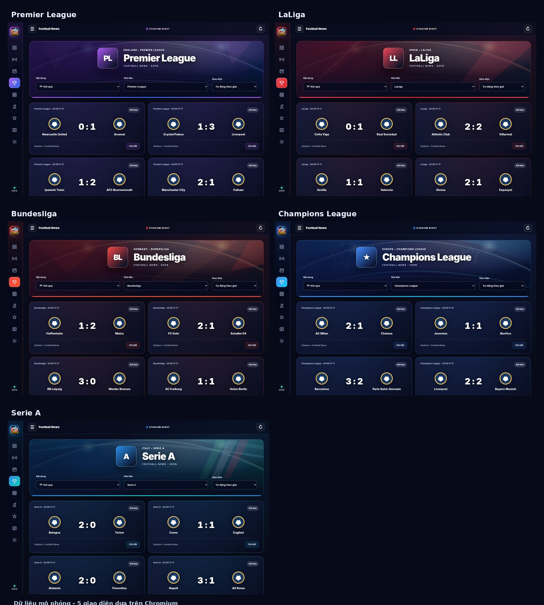

# Football News · Chỉ sử dụng dữ liệu ESPN

**Phiên bản 2026.11.27.1** — Home Assistant 2026.11+, tiếng Việt và giao diện sáng/tối.

Football News sử dụng **ESPN** cho lịch thi đấu, kết quả, bảng xếp hạng, tin bóng đá và thống kê cầu thủ. Không yêu cầu API key hoặc tích hợp dữ liệu khác. Zalo Bot chỉ dùng để **gửi thông báo**, không cung cấp dữ liệu bóng đá.

> **Lưu ý:** Các JSON endpoint ESPN được sử dụng là nguồn công khai nhưng **không có hợp đồng API chính thức**. Trang web ESPN có thể đòi xác minh trình duyệt; bản tích hợp không tìm cách vượt qua cơ chế bảo vệ đó. Số liệu thiếu sẽ không được tự tạo.

[](https://my.home-assistant.io/redirect/marketplace_repository/?owner=khaisilk1910&repository=Football-News&category=integration)


## 2026.11.27.1 — Sửa khôi phục HA Store khi mở/reload

- Đọc trực tiếp từ HA Store khi mở trang và khi nhấn **Đọc lại dữ liệu đã lưu**; đọc bắt buộc không được lấy từ RAM mirror 2 giây.
- Ưu tiên snapshot đã lưu của từng giải, ngay cả khi runtime chưa chạy, và chấp nhận dữ liệu ESPN trong RAM chỉ khi có timestamp mới hơn.
- Khôi phục nhiều giải kể cả khi Home Assistant mới nạp một phần danh sách cấu hình hoặc một giải đã thay đổi entry ID.
- Nếu việc quét cache của giải thiếu bị chậm, dữ liệu Store của các giải khác vẫn được hiển thị trước; các thiết bị được thông báo qua sự kiện cập nhật khi quét hoàn tất.
- WebView trong Companion tự đọc lại ngay nếu lần khởi tạo nhanh báo Store vẫn chưa hoàn thành, không phụ thuộc bộ đếm giờ bị tạm dừng khi màn hình ẩn.
- Đọc HA Store khi mở trang; không để thao tác đọc chậm chiếm WebSocket vô hạn. Khi Store mất thời gian, phản hồi chẩn đoán ngay rồi tiếp tục đọc ở nền và tự đồng bộ khi có dữ liệu.
- Nút **Đọc lại dữ liệu đã lưu** thực sự khởi tạo yêu cầu mới nếu yêu cầu cũ bị kẹt. Trạng thái socket cũ không thể ghi đè dữ liệu của socket mới.
- Home Assistant vẫn lưu cache trên máy chủ, không lưu riêng trên từng trình duyệt. Không gọi ESPN trong quá trình phục hồi cache.

## 2026.11.21.4 — Bảng thống kê đối chiếu và tên cầu thủ dễ đọc

- **Chi tiết trận → Thống kê:** gộp hai khối chỉ số thành một bảng 3 cột **Thông tin | Chủ nhà | Đội khách**. Tự đối chiếu theo mã thống kê ESPN, nhận diện đúng đội chủ/khách theo dữ liệu ESPN hoặc đội trong lịch thi đấu. Khi một bên không có chỉ số, hiển thị `—` thay vì gán sai giá trị.
- **Chi tiết trận → Danh sách cầu thủ:** luôn có cột vị trí đủ rộng và cột tên co giãn trên điện thoại. Cầu thủ thiếu mã vị trí được hiển thị `—`, tên không còn bị bó lại thành cột 45 px. Đội hình xuất phát, dự bị, vắng mặt vẫn tách riêng và có nhãn đếm.
- **Mã vị trí:** hiển thị `G → GK`, `D → DF`, `M → MF`, `F → FW`; các mã cụ thể như `CB`, `CDM` (kể cả dạng `CMD`), `CM`, `CF`, `LW` được giữ nguyên/chuẩn hoá khi ESPN có. Nếu ESPN chỉ cung cấp `D/M/F`, không tự suy đoán vị trí cụ thể. Khi đã đọc roster CLB cho một trận gần đây, có thể bổ sung vị trí cụ thể từ cầu thủ trùng ID.
- **Không ảnh hưởng khởi động HA:** toàn bộ thay đổi ở bảng hiển thị và dữ liệu chi tiết khi người dùng mở trận, không thêm yêu cầu ESPN lúc khởi động. Giữ lại tính năng cache-first, delay 120 giây, Live và popup.

## 2026.11.21.3 — Diễn biến Live mới nhất trước, đội hình trận rõ ràng

- **Tóm tắt trận → Diễn biến:** diễn biến mới nhất được đưa lên trên, các phút 45+2, 90+3 được sắp đúng thứ tự và sự kiện bắt đầu trận ở cuối danh sách. Không đảo thứ tự nguồn bằng CSS gây ảnh hưởng đọc màn hình; HTML đã được sắp trực tiếp.
- **Danh sách cầu thủ trong chi tiết trận:** mỗi CLB tách **Đội hình xuất phát**, **Cầu thủ dự bị** và **Không có tên trong danh sách thi đấu**; mỗi nhóm có số người và màu nền riêng. Nhãn vị trí GK, CB, CM, CF... được làm nổi bật theo nhóm thủ môn, hậu vệ, tiền vệ, tiền đạo. Trang thông tin CLB cũng có nhãn vị trí dễ nhìn hơn.
- Trạng thái dự bị chỉ áp dụng cho cầu thủ ESPN liệt kê trong danh sách trận nhưng **không đá chính**. Để xác định người *không có tên*, tích hợp chỉ truy vấn roster CLB qua HA khi người dùng mở chi tiết **trận gần đây** và danh sách thi đấu ESPN đủ tin cậy. Dùng mã cầu thủ ESPN để đối chiếu, cache 12 giờ và không truy vấn thêm trong khi khởi động HA.
- **Giới hạn nguồn:** khi ESPN không cung cấp đội hình hoặc roster chưa đầy đủ, danh sách vắng mặt sẽ ghi rõ "ESPN chưa cung cấp đủ dữ liệu để xác nhận"; không tự khẳng định một cầu thủ vắng mặt. Với trận cũ, không dùng đội hình CLB hiện nay để suy đoán ai đã dự trận trong quá khứ.

## 2026.11.21.2 — Khôi phục cache Home Assistant trước, ESPN sau 2 phút

- **Khi vừa mở Football News:** WebSocket đọc dữ liệu bóng đá đang có trong RAM Home Assistant; nếu chưa có, đọc trực tiếp snapshot `.storage` của từng giải (song song, tối đa 3 giây mỗi đợt); không chờ ESPN mới được hiển thị giao diện.
- **120 giây đầu:** sau khi config entry khởi tạo, yêu cầu ESPN tự động bị hoãn. Nếu mở Football News trước lần cập nhật ESPN đầu tiên, lần truy cập đó được bảo đảm đủ khoảng chờ 2 phút. Reload hoặc nhiều thiết bị không được kéo dài khoảng chờ liên tục. Sau đó cập nhật nền và cập nhật Live thích ứng tiếp tục như cũ.
- **Chưa có cache:** ví dụ cài mới, HA Store chưa lưu lần nào hoặc cache không còn hợp lệ, trang hiện “Chưa có dữ liệu đã lưu trên Home Assistant” và trạng thái chờ ESPN. Dữ liệu được tự đưa lên trang khi HA nhận được snapshot đầu tiên; không yêu cầu thoát ra vào lại.
- Lần đầu không tự truy vấn ESPN để lấy thống kê cầu thủ hoặc lịch sử phong độ trong khoảng chờ. Giữ nguyên yêu thích, sensor riêng theo giải, Next Round Fixtures và thông báo Live.
- **Giới hạn:** không thể hiển thị kết quả thực khi HA chưa từng lưu cache hợp lệ hoặc WebSocket HA không phản hồi. Trường hợp đó cần chờ ESPN/kết nối và xem log `custom_components.football_news: debug`.

## 2026.11.21.1 — Trận tiếp theo có hai logo và Next Round Fixtures cho Voice

- **Tổng quan → Trận tiếp theo:** mỗi trận của các CLB yêu thích trong **giải đang chọn** hiển thị dạng poster tương tự thẻ kết quả: logo đội nhà, **VS**, logo đội khách, tên hai đội và ngày giờ. Bấm vào poster để xem chi tiết. Khi hai CLB yêu thích gặp nhau, chỉ có **một** poster duy nhất; các CLB chưa có lịch được ghi rõ, không thay thế bằng trận không liên quan. Các trận đã quá hạn không bị nhầm là sắp đá.
- **Sensor `Next Round Fixtures` / `Lịch thi đấu vòng tiếp theo`:** thay cách tính 30 ngày bằng **toàn bộ cặp đấu có trong dữ liệu ESPN cho vòng tiếp theo** của từng giải. Nếu số vòng `round` được ESPN xác nhận, chọn vòng chứa trận chưa diễn ra hoặc đang Live gần nhất và liệt kê cả những trận cùng vòng đã kết thúc. Các vòng kế tiếp khác không bị lẫn vào.
- Nếu ESPN **không có số vòng**, sensor lấy một nhóm trận theo khung ngày gần nhất và đánh dấu `round_source: estimated`, `round_label: Đợt thi đấu sắp tới (ước tính)`; **không tự khẳng định đó là vòng chính thức**. Nếu ESPN thiếu trận, không thể tự bịa lịch đầy đủ.
- `state` = số cặp đấu trong vòng, với thuộc tính `round_number`, `round_label`, `round_source`, `upcoming_matches`, `total_matches`, `listed_matches`, `matches` (ID, giờ địa phương, hai CLB, trạng thái), `time_zone`, `truncated`, `voice_text` và `from_cache`. Văn bản thoại đọc đủ các cặp đấu khi kích thước cho phép; với giải có quá nhiều trận dài, `truncated` báo danh sách bị rút gọn để tránh vượt giới hạn entity Home Assistant.
- **Tương thích nâng cấp:** giữ nguyên `unique_id` sensor cũ (`schedule_next_30_days`) để không mất các automation đang tham chiếu. **Entity ID của sensor đã tồn tại có thể giữ tên cũ** dù tên hiển thị đổi thành *Next Round Fixtures*; đổi Entity ID thủ công trong Home Assistant nếu muốn. Cập nhật các automation theo Entity ID thực tế khi bạn chủ động đổi tên.
- **Voice/Assist:** `{{ state_attr('sensor.ENTITY_ID_THUC_TE', 'voice_text') or 'Chưa có lịch vòng tiếp theo.' }}`. Sensor chỉ xử lý fixture cache của Home Assistant; không thêm API request hoặc chờ ESPN khi HA khởi động.

## 2026.11.20.6 — Phong độ 10 trận và trận tiếp theo của mọi CLB yêu thích

- **Tổng quan / Trận tiếp theo:** Với giải đang chọn, hiển thị một cặp đấu gần nhất **cho từng CLB yêu thích** (tối đa 5 CLB). Nếu ESPN chưa công bố trận sắp tới của một CLB, hiển thị trạng thái chưa có lịch, không thay bằng trận của CLB khác. Nhấn vào trận để mở thông tin chi tiết.
- **Tổng quan / Phong độ gần đây:** Hiển thị độc lập **tối đa 10 kết quả gần nhất của mỗi CLB yêu thích**, theo trình tự thời gian, kèm W/D/L (thắng/hòa/thua); di chuột/chạm giữ biểu tượng để xem đối thủ, tỷ số và ngày giờ. Không dùng chỉ 5 trận hay chỉ CLB đầu tiên.
- Vì coordinator chỉ giữ khoảng 14 ngày kết quả để bảo vệ thời gian khởi động, khi mở Tổng quan, backend truy vấn thêm các **tháng lịch sử ESPN theo giải**, theo nhóm tối đa 3 tháng và dừng khi đã đủ 10 trận/đội. Mọi thiết bị dùng cùng bộ cache tháng trên Home Assistant; **không phát sinh truy vấn lịch sử trong lúc HA khởi động**.
- Dữ liệu 10 trận đã tải được lưu trong **HA Store của chính giải**, tại cùng tệp cache hiện có với dataset `history` (tối đa 100 trận, hạn 90 ngày); không dùng `localStorage` hay cache trình duyệt làm nguồn dữ liệu. Dữ liệu cũ không bị xóa khi nâng cấp.
- Khi chỉ có 1–9 trận được ESPN xác nhận, thẻ ghi rõ `x/10` và giữ các kết quả có thật. Khi ESPN lỗi/429, bản lịch sử tốt trong HA Store vẫn có thể được đọc lại, thay vì tạo dữ liệu giả. Lịch sử một giải không bị lẫn sang giải khác.
- **Giới hạn nguồn:** Chỉ tính các trận đã kết thúc và có tỷ số của chính giải đang chọn; không tự ghép thêm các giải cúp khác. Giai đoạn đầu mùa, nghỉ dài hoặc ESPN thiếu dữ liệu có thể có dưới 10 kết quả.

## 2026.11.20.5 — 5 CLB mỗi giải, trang CLB độc lập và sensor lịch 30 ngày cho Voice

- Mỗi giải đã cấu hình lưu **tối đa 5 câu lạc bộ yêu thích**. Ví dụ Premier League 5 đội + LaLiga 5 đội + Bundesliga 5 đội = 15 đội. HA Store dùng tiếp danh sách cũ, không đổi cấu trúc, không xóa dữ liệu và hỗ trợ hơn 100 CLB khi có nhiều giải.
- Tab **Câu lạc bộ của tôi** chỉ hiển thị CLB của giải đang chọn. Bộ đếm `0–5/5`, danh sách đội và yêu cầu chi tiết CLB đều theo giải; chuyển giải bằng dropdown. Lựa chọn giải của tài khoản vẫn nằm trên Home Assistant.
- Sensor của mỗi giải thuộc **device của config entry giải đó**. `Số câu lạc bộ yêu thích` chỉ đếm và liệt kê CLB thuộc giải tương ứng, không cộng các giải khác. Các sensor lịch/trận Live chỉ dùng fixtures đúng mã giải, nếu ESPN có trường này.
- Sensor mới **`Lịch thi đấu 30 ngày tới`** (`schedule_next_30_days`) xuất hiện **trong từng giải**. `state` = tổng số trận *sắp* diễn ra trong 30 ngày tính từ thời điểm đọc; các thuộc tính `league_code`, `period_start`, `period_end`, `time_zone`, `matches` (ID, ngày giờ địa phương, hai đội), `voice_text` (đoạn đọc tiếng Việt), `total_matches`, `listed_matches`, `truncated`, `from_cache`. Không tải ESPN chỉ để tạo sensor: dùng lịch đã có trong coordinator/cache `.storage`; chu kỳ cập nhật vẫn theo cơ chế cũ.
- Để dùng với **Assist/TTS**: vào **Công cụ nhà phát triển → Trạng thái**, tìm sensor *Lịch thi đấu 30 ngày tới* thuộc giải cần đọc và sao chép **Entity ID thực tế**. Trong một automation/script gửi TTS hoặc câu trả lời bằng template: 

  ```jinja2
  {{ state_attr('sensor.THAY_BANG_ENTITY_ID_CUA_GIAI', 'voice_text')
     or 'Lịch thi đấu chưa có dữ liệu.' }}
  ```

  Ví dụ phần `voice_text`: “Lịch Premier League trong 30 ngày tới, có 6 trận. Ngày 22 tháng 11, lúc 20 giờ 30: Arsenal gặp Chelsea...” Đoạn đọc giới hạn **12 trận gần nhất** để tránh câu nói quá dài; thuộc tính `matches` cung cấp thêm các cặp đấu trong khoảng 30 ngày, có giới hạn kích thước để tránh vượt ngưỡng state attributes của Home Assistant. `total_matches` luôn tính đầy đủ cả khi `truncated=true`.

**Lưu ý:** Một sensor được tạo cho mỗi **giải đang được cấu hình trong HA**, không phải cho mọi giải trong danh mục chưa cài. Nếu ESPN không cung cấp lịch tương lai, sensor không thể dự đoán trận. Dữ liệu từ cache HA được đánh dấu `from_cache=true`; lịch thay đổi/hoãn cần ESPN cập nhật thành công mới chính xác. Người dùng có thể tùy biến mẫu thoại dựa trên `matches` theo nhu cầu.

## 2026.11.20.4 — F5/reload, trang Live và thông báo 20 giây

- **F5 hoặc mở lần đầu:** Nếu coordinator đã đọc HA Store, WebSocket trả snapshot từ bộ nhớ của Home Assistant ngay, không lặp lại các thao tác đọc đĩa cho mọi giải. Trường hợp chưa có runtime vẫn dùng cơ chế đọc HA Store đã bổ sung ở bản trước.
- **Không có trận Live:** Sau khi có phản hồi dữ liệu trận đấu hợp lệ, tab Live hiển thị **“Hiện không có trận đấu trực tiếp”**. Các bản tin hoặc thống kê khác đang làm mới không giữ spinner Live vô thời hạn.
- **Thông báo góc phải:** Tự tắt sau **20 giây**; bao gồm trạng thái kết nối, lỗi, cảnh báo và popup diễn biến Live. Trạng thái lỗi dao động ngắn không làm thông báo liên tục hiện lại. Nút X vẫn đóng ngay.
- **Đồng bộ phiên bản:** Frontend và backend đều dùng 2026.11.20.4 để tránh tải nhầm JS cũ. Không thay đổi dữ liệu HA Store hoặc lịch cập nhật ESPN.

Các kiểm thử mô phỏng không chứng minh hệ thống HA thực tế đã có cache hợp lệ. Khi vẫn bị trống, xem `backend_version`, `recovery_status` và log `custom_components.football_news` để biết máy chủ không có cache hay WebSocket gặp lỗi.

## 2026.11.20.3 — Cứu dữ liệu đã lưu khi lần đầu truy cập vẫn trống

Bản vá tiếp tục xử lý báo cáo thực tế: trang có danh sách giải đấu rỗng và thông báo **Không thể lưu**, kể cả khi người dùng bấm đọc lại dữ liệu. Video 14 giây không chứa log HA, vì vậy không thể xác nhận rằng các file `.storage` vẫn tồn tại hoặc có thể đọc được; bản vá bổ sung cả cơ chế phục hồi *và* chẩn đoán để phân biệt các trường hợp.

- Sửa race condition: khi WebSocket chờ quá hạn, nó không được hủy thao tác đọc `FootballNewsCoordinator.async_restore_cache()` rồi đánh dấu `_cache_loaded=True` dù chưa đọc xong. Cache HA tiếp tục được khôi phục trong nền, không chờ ESPN.
- Khi cả config-entry registry và chỉ mục `.storage/football_news_league_registry` không có dữ liệu, WebSocket có thể tìm các file theo namespace `.storage/football_news_cache_<entry_id>` rồi đọc lại bằng **HA Store**. Chỉ sử dụng snapshot đã xác thực đúng mã giải, mùa, thời hạn và định dạng. Không sửa/xóa cấu hình HA, không tự tạo config entry hoặc gọi ESPN.
- Khi một config entry được tạo lại và có ID mới, phiên bản này có thể sử dụng bản cache cũ hợp lệ của cùng giải để hiển thị, trong khi chờ ESPN tải lại trên entry mới.
- Nếu tìm được dữ liệu cũ nhưng config entry hiện không tồn tại, bảng tỷ số/bảng xếp hạng được hiển thị ở **chế độ đọc**, không tự nhận là Live. Muốn cập nhật Live cần cấu hình/khôi phục entry trong **Cài đặt → Thiết bị & dịch vụ**.
- Không xem chỉ mục lịch sử là trạng thái *HA đang khởi động* vĩnh viễn. Nếu không có dữ liệu, giao diện hiển thị tình trạng của backend, số lượng giải đã cấu hình và số cache hợp lệ, thay vì cứ báo “Đang đồng bộ” vô thời hạn.
- Thêm `backend_version`, `registry_fallback`, `recovery_status` trong WebSocket, và warning có giới hạn khi không tồn tại snapshot hợp lệ. Giao diện ghi cảnh báo khi backend/frontend khác phiên bản.

**Cách kiểm tra sau nâng cấp:** Sao lưu và chép vào `custom_components/football_news/`, khởi động lại HA, thực hiện reload mạnh của trình duyệt (Ctrl+Shift+R hoặc mở lại WebView), xem thông tin **Backend** và **Giải cấu hình/cache hợp lệ** trong giao diện. Nếu cả hai là `0` thì không có snapshot khả dụng để phục hồi bằng cách tải lại; kiểm tra config entries, quyền truy cập `.storage` và log `custom_components.football_news` trước khi làm bước khác. Tuyệt đối không tự xóa `.storage` chỉ để xử lý màn hình trống.

**Giới hạn tại phiên bản 2026.11.20.3:** Chạy thành công 148 bài kiểm thử Python, bộ kiểm thử JavaScript và Chromium với HA WebSocket *mô phỏng*. Chưa chạy trên HA thật của người dùng; nếu hệ thống không có cache hợp lệ hoặc ghi HA Store thất bại do ổ đĩa/quyền, không thể tạo lại nội dung bằng mã nguồn frontend.

## 2026.11.20.2 — Sửa màn hình trống khi khởi động và reload từ cache Home Assistant

- Thêm một **chỉ mục cấu hình giải đấu bền vững** (`.storage/football_news_league_registry`) gồm ID config entry và mã giải đấu, không chứa API key, token hoặc dữ liệu riêng tư. Sau khi Home Assistant đã từng ghi chỉ mục này, nếu `async_entries()` tạm thời trả danh sách rỗng hoặc chưa đủ trong khi reload, WebSocket sẽ dùng chỉ mục để đọc trực tiếp các cache `.storage/football_news_cache_<entry_id>` hiện có mà **không đợi ESPN**. Khi người dùng gỡ một config entry, chỉ mục cũng được xóa.
- Đọc cache giải đấu, tùy chọn và mục yêu thích độc lập, có thời gian chờ giới hạn để lỗi trong một Store không làm cả trang mất phản hồi; dữ liệu mới trong RAM được ưu tiên. Việc lưu chỉ mục dùng `async_delay_save`, không gọi ESPN và không chặn khởi động Home Assistant.
- Chặn thao tác **ghi ngầm** tùy chọn giải đấu khi dữ liệu cấu hình đang khôi phục (trước đó gây popup **Không thể lưu** dù chưa thao tác). Chỉ lưu tùy chọn khi người dùng thay đổi lựa chọn.
- Nút **Đọc lại dữ liệu đã lưu** trong màn hình khôi phục chỉ đọc WebSocket cache HA, không gọi service làm mới ESPN khi chưa có giải. Nút reload chung cũng không gọi service nếu registry chưa có giải.
- Diagnostics bổ sung `ha_registry.native_entries`, `saved_league_codes`, `runtime_ready`. Log server có thông báo `config-entry registry incomplete` khi dùng chỉ mục HA, và `HA Store first-view cache` khi đọc được snapshot; không cần xóa dữ liệu trước khi nâng cấp.
- Thử nghiệm riêng khi registry trống nhưng có cache, stale UI state, refresh/reload trên WebView, trình duyệt thật desktop/mobile với phản hồi HA đầu tiên rỗng. **Chưa kiểm chứng trực tiếp trên HA của người dùng**, nên hãy cung cấp log/diagnostics nếu vẫn lỗi sau khi cài.

## 2026.11.20.1 — Khắc phục màn hình trống khi mở lần đầu

Khi vào Football News, frontend gọi `football_news/data` để lấy dữ liệu **đã lưu trong `.storage` của Home Assistant** trước khi cần làm mới ESPN. Ngay cả khi HA vừa khởi động, coordinator chưa có dữ liệu, hoặc ứng dụng điện thoại báo WebView đang ẩn, giao diện vẫn tự thử lại ngay trong lần mở đó. Nếu bảng xếp hạng/lịch trong RAM còn rỗng, backend lấy feed còn thiếu từ HA Store mà không ghi đè feed mới.

Trong lúc chờ, Tổng quan hiển thị trạng thái khôi phục và nút Làm mới thay vì khu vực trống. Không xóa `.storage`, không cài lại integration và không cần đăng nhập lại. Cache được đánh dấu là dữ liệu đã lưu, không tự nhận là Live chính xác. Nếu HA chưa từng lưu bản hợp lệ (hoặc cache đã quá tuổi/mùa), vẫn cần ESPN tải thành công một lần mới có dữ liệu để hiển thị.

**Kiểm tra trên HA thật:** Mở trang Tổng quan ngay sau khi HA khởi động, không thoát ra; kiểm tra log `Football News restored disk cache` và `Football News HA Store first-view cache`. Cũng thử trên mobile WebView. Những bài kiểm thử tự động không thay thế kiểm thử thực tế với thiết bị của bạn.

## Stadium Night — Giao diện được xây dựng lại hoàn toàn



**Không còn giao diện cũ cộng thêm banner.** Stadium Night thay toàn bộ bố cục dashboard: thanh điều hướng biểu tượng ở cạnh trái trên desktop; thanh trên cùng gọn nhẹ; khu vực sân vận động tích hợp trực tiếp **logo/tên giải, chọn Nội dung, Giải đấu và Giao diện**; thẻ trận với logo/tỷ số lớn; bảng xếp hạng dạng bảng thể thao tối, cột chỉ số căn giữa; khối tin tức, cầu thủ và CLB theo cùng hệ thiết kế.

**Năm bộ nhận diện:** Premier League (tím), LaLiga (đỏ), Bundesliga (đỏ/cam), UEFA Champions League (xanh điện), Serie A (xanh lam/ngọc). Ở bộ chọn **Giao diện**, dùng **Tự động theo giải** (mặc định) hoặc cố định một kiểu. Tùy chọn giao diện được lưu trên Home Assistant theo tài khoản đăng nhập và đồng bộ giữa các thiết bị dùng cùng tài khoản.

**Responsive:** desktop hiển thị thanh rail và lưới 2 cột; điện thoại ẩn rail, giữ nút mở menu Home Assistant và xếp thẻ trận thành 1 cột. Tên CLB có thể xuống dòng, logo/tỷ số tự điều chỉnh theo thẻ; bảng xếp hạng có vùng cuộn ngang nội bộ khi quá hẹp. Các phần vẫn giữ tương thích với dropdown, đội yêu thích, popup, thông báo Zalo và dữ liệu cache.

**Tối ưu tốc độ:** 5 hình sân vận động khác nhau là SVG nội bộ (mỗi file khoảng 1,6–1,8 KB), không có thư viện frontend, font ngoài hoặc ảnh nền lớn. Giao diện không gọi thêm ESPN khi đổi màu. Logo CLB chỉ dùng link có sẵn trong feed ESPN và tải lazy; không tải chân dung cầu thủ. RAM/cache `.storage` và đồng bộ ESPN nền không đổi. Đồ họa dùng CSS chuyển màu nhẹ và tôn trọng `prefers-reduced-motion`.

Chú ý: Giao diện Stadium Night có tông tối chủ đạo để phù hợp ảnh tham chiếu, độc lập với màu theme của Home Assistant. Các thành phần vẫn có độ tương phản cao và hoạt động trong cả chế độ sáng/tối của Home Assistant.

## 2026.11.19.4 - Popup su kien Live tren moi tab Football News

- Khi co tran Live o **bat ky giai dau da cau hinh** nao, Home Assistant kiem tra them ESPN `summary.keyEvents` / `scoringPlays` theo nhip Live (mac dinh khoang 20 giay) va phat su kien moi qua `football_news_live_event`. Viec nay **khong can mo chi tiet tran**; trang web chi nhan su kien tu Home Assistant, khong tu truy van ESPN.
- Popup Stadium Night hien **logo 2 doi, ty so hien tai, ban thang/the vang/the do, ten cau thu, phut xay ra, ten giai** va nut **Xem dien bien**. Mau xanh la ban thang, vang la the vang, do la the do. Hoat dong tren tat ca tab: Tong quan, Live, Lich, Ket qua, BXH, Cau lac bo, Cau thu, Tin tuc va Cai dat; khong phu thuoc giai dang xem.
- Popup tu dong dong sau khoang **24 giay** hoac dong bang nut X; toi da 3 popup cung luc, cac su kien den tiep theo duoc xep hang. Du lieu chi giu trong RAM trang dang mo, khong phai cache theo thiet bi.
- **Chong thong bao cu/trung**: lan tai dien bien dau tien tao moc baseline, khong nhay lai cac ban thang cu khi restart Home Assistant. ESPN phat lai mot su kien se khong tao popup trung. Chi thong bao neu ESPN cung cap dien bien co the nhan dien, khong suy dien cau thu/tinh huong.
- **Pham vi:** popup trong cac tab Football News **dang mo**; khong phai thong bao day he dieu hanh khi nguoi dung da thoat trang. Khi ESPN khong cung cap timeline/cau thu/phut, thong tin thieu se duoc ghi ro va co the khong hien popup. Toc do thong bao phu thuoc ESPN va chu ky Live; khong phai push tuc thoi.

## 2026.11.19.3 — Tự động cập nhật thích ứng theo trận Live

- Home Assistant tự thay đổi lịch truy vấn cho **từng giải đã cấu hình**, không cần mở dashboard: **5 phút** khi rảnh; **2 phút 30 giây** trước trận 1–3 giờ; **60 giây** khi còn 10–60 phút; **30 giây** sát giờ bóng lăn hoặc ESPN chưa chuyển trạng thái Live; **20 giây** mặc định khi ESPN xác nhận `state=in`; **60 giây** trong 4 giờ đầu sau giờ bắt đầu trận đã kết thúc để chờ xác nhận kết quả. Không duy trì tốc độ cao nếu trạng thái Live bị kẹt hơn 6 giờ.
- Vào **Settings → Devices & services → Football News → Configure** để chọn `Chu kỳ làm mới tỷ số khi trận đang Live`: **15 / 20 / 30 / 45 / 60 giây** trên từng giải. 20 giây là mức cân bằng; 15 giây tăng lượng yêu cầu ESPN và khả năng gặp 429.
- **Tỷ số Live dùng endpoint scoreboard theo ngày `YYYYMMDD`**, cache độc lập 12 giây, ghép các bản cập nhật theo event ID vào lịch đầy đủ. Hết phụ thuộc vào TTL 120 giây của lịch theo tháng khi đang Live. Lịch 14 ngày/35 ngày tiếp tục được kiểm tra khoảng 5 phút để tránh tải lịch lớn mỗi 20 giây.
- Khi đang mở **Chi tiết trận Live**, diễn biến/thống kê được tải lại khoảng **15 giây/lần**, chia sẻ cache ESPN trên Home Assistant giữa các thiết bị. Dừng khi đóng chi tiết, ẩn tab hoặc trận không còn Live (duy trì tối đa 5 phút để nhận kết quả cuối).
- Giữ kết quả gần nhất khi ESPN lỗi, hạn chế yêu cầu với single-flight, cooldown 90 giây (429 là 300 giây), semaphore mạng toàn cục. Chỉ lưu `.storage` khi dữ liệu thay đổi hoặc sau 5 phút, không gửi trùng thông báo nếu ESPN trả nguyên trạng thái cũ.
- `Download diagnostics` có thêm `adaptive_refresh` (mode/seconds/focused_days) và `live_refresh_seconds_setting`; log INFO khi đổi chế độ, DEBUG cho mỗi lượt kiểm tra và WARNING được hạn tần suất khi ESPN lỗi.
- Không thay đổi cơ chế khởi động Home Assistant: ESPN vẫn bắt đầu tải nền sau sự kiện Home Assistant started. Không thêm nguồn thể thao thứ hai hoặc API key.

**Giới hạn quan trọng:** Chu kỳ 15–20 giây là khoảng cách giữa **các lần kiểm tra**, không phải cam kết tỷ số xuất hiện sau đúng 15–20 giây. ESPN có thể cập nhật chậm, bị lỗi hoặc trả HTTP 429. Nếu có nhiều trận Live ở nhiều giải, số yêu cầu vẫn tăng theo số giải cấu hình.

## 2026.11.19.2 — Mở Football News lần đầu tự tải dữ liệu

Bản vá xử lý tình trạng vào sidebar lần đầu chỉ hiện **“Đang đồng bộ giải đấu”**, sau đó người dùng phải thoát và mở lại:

- Nếu Home Assistant chưa gán thuộc tính `hass` cho custom panel, giao diện tiếp tục kiểm tra trạng thái và tự tải dữ liệu khi WebSocket có sẵn.
- Nếu lời gọi WebSocket đầu tiên trả registry rỗng trong lúc Home Assistant đang khởi động, backend kiểm tra lại registry nội bộ tối đa 1 giây (không kết nối ESPN) và báo trạng thái `startup_pending` để frontend không kết luận sai là chưa cấu hình giải đấu.
- Ngay sau khi coordinator khôi phục cache trên đĩa, backend phát sự kiện cho các thiết bị đang mở để giao diện tải lại tức thì; không đợi request ESPN.
- **Thiết bị di động:** khi WebView báo `document.hidden` quá sớm, việc thử lại vẫn tiếp tục nếu chưa có dữ liệu. Sau khi tải được, request chạy nền sẽ được giới hạn để tránh hao pin và băng thông.
- Nếu kết nối WebSocket bị thay đổi khi request trước chưa xong, giao diện tự thử lại trên kết nối mới. Có nâng phiên bản file frontend để tránh dùng JavaScript cũ từ browser cache.

Để xác nhận: khởi động lại Home Assistant, mở Football News **một lần** và giữ trang đó. Khi đã có cache trên Home Assistant, dữ liệu cũ sẽ hiển thị trước; nếu cache chưa có, phải chờ ESPN hoàn tất lần tải dữ liệu đầu tiên. Không có yêu cầu truy cập ESPN nào chặn tiến trình khởi động Home Assistant.

## 2026.11.19.1 — Một nguồn dữ liệu cho mọi thiết bị

- **Không còn lưu snapshot, thống kê cầu thủ, tab/giải hay giao diện trong `localStorage`/`sessionStorage`.** Trình duyệt chỉ giữ dữ liệu đang hiển thị trong RAM; tải lại trang hoặc mở thiết bị mới sẽ đọc Home Assistant qua WebSocket.
- **Lịch, kết quả, bảng xếp hạng, tin, cầu thủ**: cache chung tại RAM và `.storage/football_news_cache_<entry_id>` của Home Assistant. Định kỳ làm mới dữ liệu từ ESPN sau khi Home Assistant đã khởi động; không chặn startup bằng request ESPN.
- **CLB/trận/giải yêu thích**: lưu chung trong `.storage/football_news_preferences` cho các tài khoản Home Assistant (chỉ quản trị viên được sửa từ dashboard). **Tab, giải đang xem và bộ màu**: lưu tại `.storage/football_news_ui_state` theo tài khoản Home Assistant, nên cùng một tài khoản trên máy tính/điện thoại có cùng lựa chọn nhưng các tài khoản khác không làm thay đổi màn hình của nhau.
- Thay đổi dữ liệu trận đấu, cầu thủ, mục yêu thích và tùy chọn được thông báo bằng HA event qua WebSocket tới các panel đang mở. Khi mất kết nối, tab đang mở có thể tạm giữ dữ liệu RAM hiện tại; **không ghi nó thành một bản lưu riêng theo thiết bị**.
- Dùng `Store` và xác nhận ghi thành công trước khi trả kết quả lưu; sửa lỗi ghi ổ đĩa sẽ hoàn nguyên dữ liệu yêu thích chưa được lưu. `Download diagnostics` bổ sung loại lưu trữ; bật `custom_components.football_news: debug` để kiểm tra phục hồi cache, revision UI state, lỗi ESPN và timestamp của từng giải.
- Tương thích cấu trúc HACS/Marketplace với `hacs.json`, `manifest.json`, config flow, options flow, sensor/binary_sensor, services, diagnostics và custom panel. Kể từ Home Assistant 2026.11, **Marketplace** tích hợp sẵn thay thế HACS trước đây. Việc cài bản ZIP trong cuộc trò chuyện này là cài thủ công; muốn cập nhật qua Marketplace cần đưa mã mới lên repository GitHub.

## 2026.11.13.8 — Dữ liệu ESPN và cache khi tải lại

Bản này khắc phục trường hợp Home Assistant hiển thị `Standings response has no standings content` khi ESPN trả HTTP 200 nhưng payload không có bảng xếp hạng thực tế. Bộ đọc hỗ trợ cấu trúc bảng lồng nhau, dùng tối đa một endpoint dự phòng cũng thuộc ESPN và kiểm tra mùa hiện tại. Nếu cả hai nguồn tạm lỗi, bảng hợp lệ cuối cùng từ RAM/`.storage` vẫn hiển thị (có thời điểm cập nhật, không giả là dữ liệu trực tiếp).

**Lưu `.storage` theo từng dataset:** khi lịch thi đấu tải được trước nhưng bảng xếp hạng tải về sau, dữ liệu bảng vẫn được lên lịch ghi vào HA Store; không còn bị bỏ qua do giới hạn ghi chung 120 giây. `Store` tự trì hoãn ghi ngắn để tránh I/O dồn dập. Cache không thể tạo dữ liệu mà ESPN chưa từng cung cấp; dashboard sẽ cho biết thiếu dữ liệu khi cả cache và upstream đều không có.

**Chẩn đoán:** bật mức debug qua Home Assistant `logger`, ví dụ:

```yaml
logger:
  logs:
    custom_components.football_news: debug
```

Sau đó kiểm tra **Download diagnostics**, trường `updated_at`, `cache_info.restored_datasets`, `errors` của từng giải. Không xóa config entry hoặc tệp `.storage` khi đang kiểm tra vì có thể mất dữ liệu khôi phục. Bản này không khẳng định nguồn ESPN sẽ luôn trực tuyến: HTTP 403/429 và thay đổi schema vẫn có thể xảy ra.

## Cài đặt

### Marketplace

1. Bấm nút trên hoặc mở **Cài đặt → Marketplace** và thêm repository `https://github.com/khaisilk1910/Football-News` dưới loại Integration.
2. Cài Football News, khởi động lại Home Assistant.
3. Mở **Cài đặt → Thiết bị & dịch vụ → Thêm tích hợp → Football News**, chọn từng giải.
4. Trong sidebar mở Football News; chọn giải đấu từ dropdown.

### Thủ công

Giải nén ZIP phát hành `football_news.zip` vào `/config/custom_components/football_news/` sao cho thư mục có trực tiếp `manifest.json` và `__init__.py`. Khởi động lại Home Assistant và thêm tích hợp từ giao diện.

## Tính năng

- Lịch / vòng đấu, kết quả, trận trực tiếp, đội yêu thích, bảng xếp hạng và màu suất dự cúp/xuống hạng.
- Dashboard tiếng Việt có 5 bộ màu sân vận động tự đổi theo giải, phù hợp điện thoại, dropdown và theme Home Assistant sáng/tối.
- Thống kê theo mùa từ ESPN: ghi bàn, kiến tạo, thẻ vàng/đỏ, điểm đánh giá, số trận và số phút nếu feed có đủ dữ liệu được xếp hạng.
- Bảng cầu thủ dạng 4 cột: thứ hạng, **logo câu lạc bộ ESPN**, tên + câu lạc bộ và chỉ số bên phải. Không tải ảnh chân dung cầu thủ; thiếu logo dùng biểu tượng dự phòng.
- Vị trí Top 1/2/3 được nhấn viền vàng/bạc/đồng; hạng tiếp theo sử dụng màu trung tính.
- **Tổng quan:** Top 3 bàn thắng và Top 3 kiến tạo. **Cầu thủ nổi bật:** tối đa **Top 15** của mỗi loại khi ESPN cung cấp đủ cầu thủ; không tự bổ sung vị trí còn thiếu.
- **Bố cục responsive:** trên máy tính có đủ chiều rộng, hai bảng **Vua phá lưới** và **Kiến tạo hàng đầu** hiển thị **hai cột ngang nhau**. Trên điện thoại hoặc vùng nội dung hẹp, tự động xếp thành **một cột**, theo chiều rộng thực tế của panel Home Assistant (không phụ thuộc vào kích thước màn hình thiết bị).
- **SVG mới:** bóng đá có các mảng ghép rõ nét và giày chuyền bóng kèm bóng chuyển động; dùng màu vàng/bạc/đồng cho ba vị trí đầu, không tải ảnh hoặc biểu tượng từ bên ngoài.
- Các nhóm thẻ phạt/đánh giá khác giữ mức Top 3 nếu ESPN có số liệu.
- Thông báo Zalo qua action `zalo_bot.send_message`, danh sách chọn nhiều đội theo ID, nhắc trước trận, bàn thắng và kết quả.
- Không truy vấn mạng trong quá trình khởi động tích hợp. Chỉ nạp bảng cầu thủ khi mở trang cần, cache kết quả 6 giờ, giới hạn yêu cầu đồng thời và ngắt khi ESPN giới hạn truy cập.
- **Cache chung hai tầng**: RAM trong ESPN provider/coordinator và Home Assistant `.storage` qua `Store` (không dùng browser storage). **Ngay lần đầu mở sidebar**, backend có thể đọc trực tiếp `.storage` theo config entry kể cả khi coordinator chưa khởi tạo; không cần rời dashboard rồi quay lại. Dữ liệu cũ được đánh dấu lưu tạm cho tới khi ESPN cập nhật.
- **Thống kê cầu thủ** được lưu riêng theo giải/mùa, ưu tiên RAM/disk trong thời hạn 6 giờ, không tải ảnh chân dung. Dữ liệu thiếu mạng có thể hiển thị bản đã lưu trong hạn tối đa 24 giờ và có nhãn dữ liệu tạm.
- Dữ liệu khôi phục từ disk luôn được **đánh dấu lưu tạm**; không coi trạng thái trực tiếp cũ là đang diễn ra. ID người nhận Zalo, API key, cấu hình tài khoản và danh sách yêu thích cá nhân không được ghi vào cache dữ liệu bóng đá.
- Không có chức năng Donate hoặc cá cược.

## Dữ liệu cầu thủ ESPN

Trang thống kê tham chiếu: https://www.espn.com/soccer/stats/_/league/eng.1

Nguồn JSON ESPN được thử theo thứ tự: `sports.core.api.espn.com/v2/sports/soccer/leagues/{league}/seasons/{season}/types/2/leaders`, `/seasons/{season}/leaders`, `/leaders`, sau đó các endpoint ESPN Site/Web có thể cung cấp cùng nhóm dữ liệu. Định dạng của ESPN có thể thay đổi. Các endpoint này **không phải API hỗ trợ chính thức**. Nếu JSON của ESPN trả dữ liệu khác với trang web, Football News chỉ hiển thị giá trị xác thực được.

Để tránh lỗi 404, tốn băng thông và chờ ảnh, bảng thống kê Football News **không tải ảnh cầu thủ**. Tên, câu lạc bộ, bàn thắng và kiến tạo vẫn đến từ ESPN; biểu tượng bóng và giày chuyền bóng được dựng cục bộ bằng SVG.

Season của Premier League 2026–27 dùng `2026`; các giải theo năm lịch có mùa riêng. Giao diện ẩn bảng Top nếu không có cầu thủ hợp lệ.

## Cache RAM + ổ đĩa chung (2026.11.19.1)

Tích hợp sử dụng cache chung tại Home Assistant, không truy vấn ESPN hoặc gọi Zalo trong `async_setup_entry`:

| Tầng | Chức năng | Ghi chú |
|---|---|---|
| RAM | Cache TTL của provider ESPN và bản tốt gần nhất trong coordinator | Phản hồi nhanh khi Home Assistant đang chạy, không ghi đĩa cho mọi lần đọc |
| Ổ đĩa | `homeassistant.helpers.storage.Store`, khóa `football_news_cache_<entry_id>` | Dữ liệu ESPN công khai, tách từng giải và xác minh đúng mùa. Đọc bất đồng bộ ngay từ WebSocket kể cả trước khi coordinator sẵn sàng |
| Mỗi trình duyệt | RAM tạm thời của trang đang mở, **không lưu lâu dài** | Máy tính/điện thoại đều nhận dữ liệu từ Home Assistant; không tạo cache cố định khác nhau theo thiết bị |

**Thời hạn tối đa để khôi phục từ ổ đĩa:** lịch/kết quả 45 ngày, bảng xếp hạng 75 ngày, tin 14 ngày, thống kê cầu thủ 48 giờ. Cache cầu thủ đủ mới được sử dụng trực tiếp trong 6 giờ; bản cũ chỉ dùng dự phòng khi ESPN tạm lỗi. **Không có nghĩa dữ liệu còn mới**: mỗi nhóm giữ thời điểm cập nhật ESPN gốc, khi khôi phục có cảnh báo, và bộ đếm trận trực tiếp của Home Assistant chỉ có hiệu lực khi đã cập nhật lịch mới. Phản hồi lỗi không ghi đè dữ liệu tốt; nếu ESPN trả danh sách rỗng sau khi từng có dữ liệu, Football News chờ xác nhận từ lần cập nhật thành công tiếp theo trước khi xóa. Cache bị lỗi, quá hạn, khác giải/mùa hoặc quá lớn sẽ bị bỏ qua. Sau khi ESPN cập nhật, dữ liệu thực được thay vào từng nhóm.

Để bảo vệ thẻ nhớ/SSD, ghi disk được hoãn 2 giây bởi `Store.async_delay_save` thay vì ghi với mỗi yêu cầu WebSocket; lưu kết quả cầu thủ theo yêu cầu khi có dữ liệu mới. Tích hợp không cần cấu hình tay file cache. **Không xóa thư mục `.storage`**, không chỉnh tay cache. Dữ liệu Zalo và danh sách CLB yêu thích vẫn được quản lý riêng bằng cơ chế hiện có, không đưa vào cache ESPN.

**Tiêu đề các thẻ:** chữ đậm, cỡ chữ rõ hơn, vạch nhấn đỏ, nền phân lớp nhẹ theo theme và nút “Xem tất cả” có độ tương phản cao. Đã kiểm tra bằng Chromium trong theme sáng/tối trên 320–1366 px; không tuyên bố tương thích mọi custom theme chưa thử.

Khi xác minh cache, hãy tải một giải đấu thành công, khởi động lại Home Assistant và mở Football News. Dữ liệu cũ cần xuất hiện kèm nhãn **dữ liệu lưu tạm** cho đến khi ESPN trả lời. Trong **Download diagnostics**, xem `disk_cache.restored_datasets`. Bật log debug để xem thông báo `restored disk cache league=...` hoặc lý do cache bị bỏ qua. Nếu bản cài chưa từng tải ESPN thành công, cache không thể tự tạo dữ liệu.

## Sửa lỗi mở sidebar lần đầu (2026.11.13.1)

Lỗi cũ: Khi Home Assistant đã lưu giải đấu nhưng `async_setup_entry` chưa cấp phát coordinator, lệnh WebSocket trước đây chỉ lấy cache từ coordinator, trả về giải đấu với dữ liệu trống. Frontend liên tục hiện **“Đang đồng bộ danh sách giải đấu”** và đôi khi chỉ hiện dữ liệu sau khi thoát rồi vào lại.

Phiên bản này thêm `cold_start.py` dùng `FootballColdStartCache`: đọc snapshot `.storage` **theo ID config entry + mã giải + mùa** độc lập với coordinator. Lần gọi WebSocket đầu tiên có thể trả về dữ liệu lưu trên đĩa khi Home Assistant đang khởi tạo platform. Coordinator vẫn được khôi phục bằng tác vụ nền ngay sau khi đăng ký, và **không đợi ESPN** trong `async_setup_entry`. Khi ESPN trả dữ liệu mới, dashboard cập nhật từng nhóm.

Frontend cũng bỏ việc chờ truy vấn cầu thủ trong lượt tải WebSocket chính; cơ chế thử lại chạy liên tục với thời gian chờ tối đa 15 giây giữa các lượt khi vẫn đang hiển thị dữ liệu cũ/chưa sẵn sàng. Cache sai giải/mùa, quá hạn hoặc chưa từng lưu thành công không được hiển thị thành dữ liệu mới. Nếu cache trống, lần đầu vẫn phải chờ ESPN tải xong; điều này không thể loại bỏ bằng cache.

**Kiểm chứng:** Sau khi cập nhật, mở một giải từng có lịch hoặc bảng xếp hạng, khởi động lại HA và vào Football News một lần duy nhất. Lúc chờ nguồn mới, bảng cần hiển thị dữ liệu cũ và cảnh báo cache. Nếu không, mở Download diagnostics, bật log debug `custom_components.football_news` và kiểm tra có file `.storage/football_news_cache_<entry_id>` (không cần gửi ID cho người khác).

## Cấu hình Zalo

**Thông báo bàn thắng có cầu thủ/phút (2026.11.21.5):** Khi bật Zalo và tùy chọn *bàn thắng/cập nhật tỷ số*, tích hợp so sánh tỷ số ESPN trước và sau khi cập nhật. Nếu có bàn thắng mới, Home Assistant đối chiếu với ESPN Match Summary (cache chung, chờ tối đa 5 giây) trước khi gửi Zalo. Khi xác nhận được người ghi bàn, tin nhắn sẽ có tên cặp đấu, tỷ số, **đội ghi bàn**, **cầu thủ**, **phút ghi bàn** (bao gồm phút bù giờ), và giải đấu. Nếu ESPN chưa xác nhận danh tính/phút hoặc Summary chưa khớp tỷ số, tin nhắn vẫn gửi tỷ số đã xác nhận và ghi rõ chưa thể xác minh người ghi bàn — không lấy tên từ một bàn thắng cũ.

**Chi tiết diễn biến trên Zalo (2026.11.21.7):** Thông báo bàn thắng nay bổ sung dòng `📝 Diễn biến (ESPN)` chứa nguyên văn lời tường thuật của **chính bàn thắng mới được đối chiếu với tỷ số** (ví dụ vị trí dứt điểm, chân sút, góc bóng, kiến tạo). Văn bản giữ nguyên ngôn ngữ ESPN; không tự dịch, bịa người kiến tạo hoặc lấy diễn biến bàn thắng cũ. Nếu sự kiện không có mô tả, tin nhắn vẫn có tỷ số, cầu thủ và phút; nếu Summary chưa khớp, chỉ thông báo tỷ số cùng cảnh báo chưa xác minh. Mô tả được giới hạn độ dài và lọc ký hiệu định dạng Zalo để tránh hỏng thông báo. Không tăng truy vấn ESPN lúc khởi động Home Assistant.


Ví dụ nội dung: `⚽ BÀN THẮNG · Manchester City 1 - 1 Fulham · Manchester City · Cầu thủ: ... · Phút: 78'`. Đây chỉ là mẫu, không phải dữ liệu trận đấu thực tế. Các automation Zalo độc lập do bạn tự tạo không tự động thay đổi mẫu thông báo; thay đổi này áp dụng cho **Zalo Bot tích hợp sẵn trong Football News**.


Mở **Thiết bị & dịch vụ → Football News → Cấu hình**. Chọn nhiều đội trong dropdown (để trống = toàn giải). Nhập tài khoản gửi và ID người nhận dạng **chuỗi** theo README của Zalo Bot; bật Markdown của Zalo Bot để định dạng tin nhắn.

## Sửa lỗi thread-safety khi lưu đội yêu thích (2026.11.12.8)

- Sửa listener `football_news_preferences_updated` trong `sensor.py` thành phương thức `@callback` được Home Assistant chạy trực tiếp trên event loop.
- Không còn gọi `async_write_ha_state()` trong executor thread khi cập nhật đội yêu thích hoặc tải preferences. Listener được hủy khi entity bị tháo khỏi Home Assistant.
- Đây là bản vá Python: **phải khởi động lại Home Assistant sau khi cập nhật**. Không cần xóa hay tạo lại các giải đấu, đội yêu thích hoặc thiết lập Zalo.
- Nếu còn thông báo mới về thread-safety, bật log debug và gửi traceback mới (có thể chỉ ra một hàm khác).

## Chẩn đoán lỗi

Trong `configuration.yaml`:

```yaml
logger:
  default: warning
  logs:
    custom_components.football_news: debug
```

Kiểm tra **Cài đặt → Thiết bị & dịch vụ → Football News → Download diagnostics**. Log ghi mã giải, mùa, domain ESPN và loại lỗi, không ghi nội dung Zalo riêng tư. Nếu thấy HTTP 403/429, tránh làm mới liên tục.


## Giấy phép

Xem file `LICENSE` trong repository. ESPN và các nhãn hiệu bóng đá thuộc chủ sở hữu tương ứng; repository không phải sản phẩm chính thức của ESPN hoặc Home Assistant.


